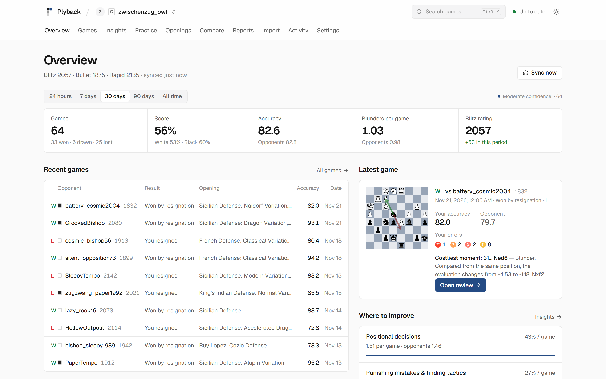
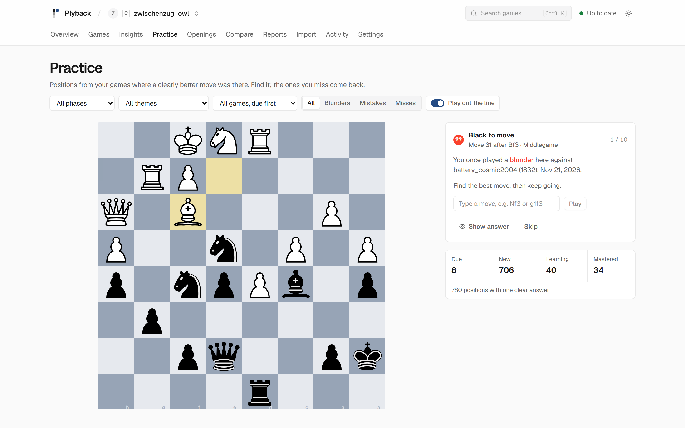

<p align="center">
  
</p>

<h1 align="center">Plyback</h1>

<p align="center">Self-hosted game review for Chess.com and Lichess, powered by Stockfish.</p>

<p align="center">
  <a href="https://github.com/klemen-r/plyback/releases/latest"></a>
  <a href="https://github.com/klemen-r/plyback/actions/workflows/ci.yml"></a>
  <a href="LICENSE"></a>
</p>

<p align="center">
  <a href="#install">Install</a> ·
  <a href="docs/self-hosting.md">Self-hosting</a> ·
  <a href="docs/methodology.md">Methodology</a> ·
  <a href="https://github.com/klemen-r/plyback/releases">Releases</a>
</p>

<picture>
  <source media="(prefers-color-scheme: dark)" srcset="docs/screenshots/review-dark.png">
  
</picture>

Plyback imports the games you play, reviews every one with Stockfish in the background and turns the
reviews into things to work on: the mistakes you keep repeating, the openings where you go wrong, and
positions from your own games to solve again. It runs on your own machine as a single program with a
SQLite database. It needs no Chess.com or Lichess password and no subscription.

## Features

- **Review** every game: move classifications, evaluation graph, engine lines, key moments, and free
  exploration on the board.
- **Insights** across an account: openings, game phases, recurring mistakes, time use, converting
  advantages, and playing sessions, each with a confidence label and links to the positions behind it.
- **Practice** positions taken from your own mistakes, on a spaced-repetition schedule, filtered by
  phase or tactical theme.
- **Openings** as a move tree of your games: results per line, where you leave theory, and the moves
  that keep losing.
- **Sync** public games from Chess.com and Lichess automatically, or import PGN files.
- **Compare** periods or accounts side by side, and save reports as fixed snapshots.

<table>
  <tr>
    <td width="50%" align="center">
      <picture>
        <source media="(prefers-color-scheme: dark)" srcset="docs/screenshots/overview-dark.png">
        
      </picture>
      Overview
    </td>
    <td width="50%" align="center">
      <picture>
        <source media="(prefers-color-scheme: dark)" srcset="docs/screenshots/insights-dark.png">
        
      </picture>
      Insights
    </td>
  </tr>
  <tr>
    <td width="50%" align="center">
      <picture>
        <source media="(prefers-color-scheme: dark)" srcset="docs/screenshots/practice-dark.png">
        
      </picture>
      Practice
    </td>
    <td width="50%" align="center">
      <picture>
        <source media="(prefers-color-scheme: dark)" srcset="docs/screenshots/openings-dark.png">
        
      </picture>
      Openings
    </td>
  </tr>
</table>

The screenshots use sample data: 360 engine games for a fictional player rated around 2000, imported
and reviewed by Plyback itself. In daily use on an ordinary desktop PC it keeps an account of over
1,300 games (78,000 moves) fully reviewed.

## Install

**Download** the archive for Windows, macOS or Linux from the
[latest release](https://github.com/klemen-r/plyback/releases/latest), unpack it and start `plyback`
(`plyback.exe` on Windows). Stockfish is included.

**Docker**, for home servers (amd64 and arm64):

```sh
docker run -d --name plyback --restart unless-stopped -p 8000:8000 -v plyback-data:/data \
  -e PLYBACK_PASSWORD='choose-a-strong-one' ghcr.io/klemen-r/plyback:3
```

Then open [localhost:8000](http://localhost:8000) and add a Chess.com or Lichess username. Plyback
imports the account's history, reviews it in the background and checks for new games every few minutes.

The [self-hosting guide](docs/self-hosting.md) covers building from source, access from other devices,
reverse proxies, backups and upgrades.

## How it works

A Rust server (Axum, shakmaty) syncs games, runs a queue of Stockfish workers and stores everything in
SQLite. The interface is React and TypeScript. Positions already searched are cached, so re-reviews are
fast, and an interrupted review continues after a restart.

Classifications use documented heuristics based on expected-points loss, not Chess.com's proprietary
algorithm, so labels and accuracy can differ from Chess.com. The [methodology](docs/methodology.md)
describes every rule and threshold.

## Documentation

- [Self-hosting](docs/self-hosting.md): install options, network access, backups, upgrades, configuration
- [Methodology](docs/methodology.md): how moves are classified and insights are computed
- [Architecture](docs/architecture.md): components, data model, analysis pipeline
- [Security](SECURITY.md): what is protected and how to run behind a proxy
- [Contributing](CONTRIBUTING.md): development setup, checks and releases

## License

[GPL-3.0-or-later](LICENSE). Release archives and the container image include Stockfish (GPL-3.0) with
its notices. Opening names come from the CC0
[Lichess chess-openings](https://github.com/lichess-org/chess-openings) dataset. See
[third-party notices](THIRD_PARTY_NOTICES.md).
