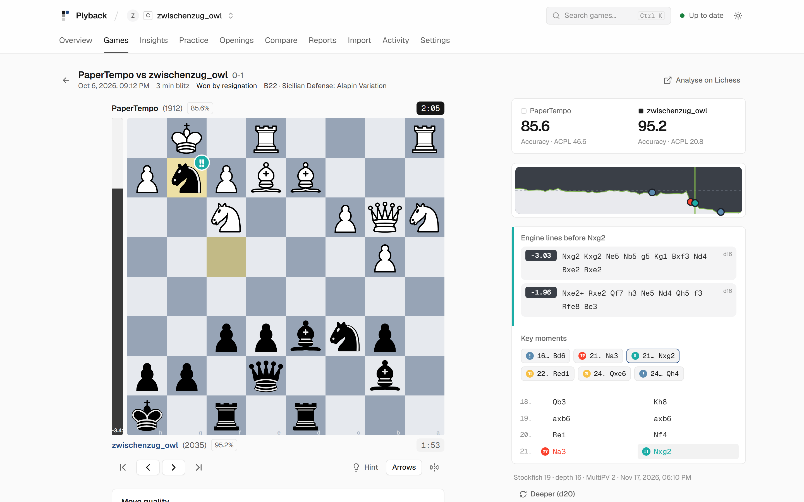
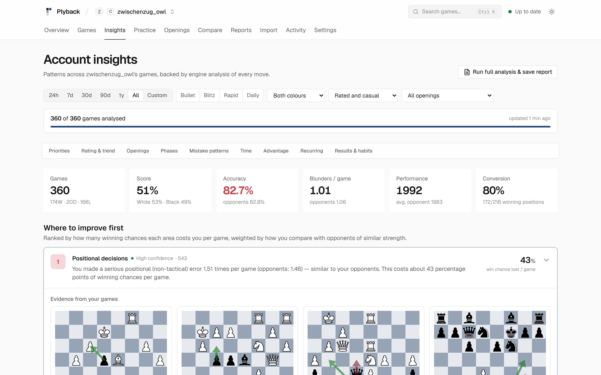
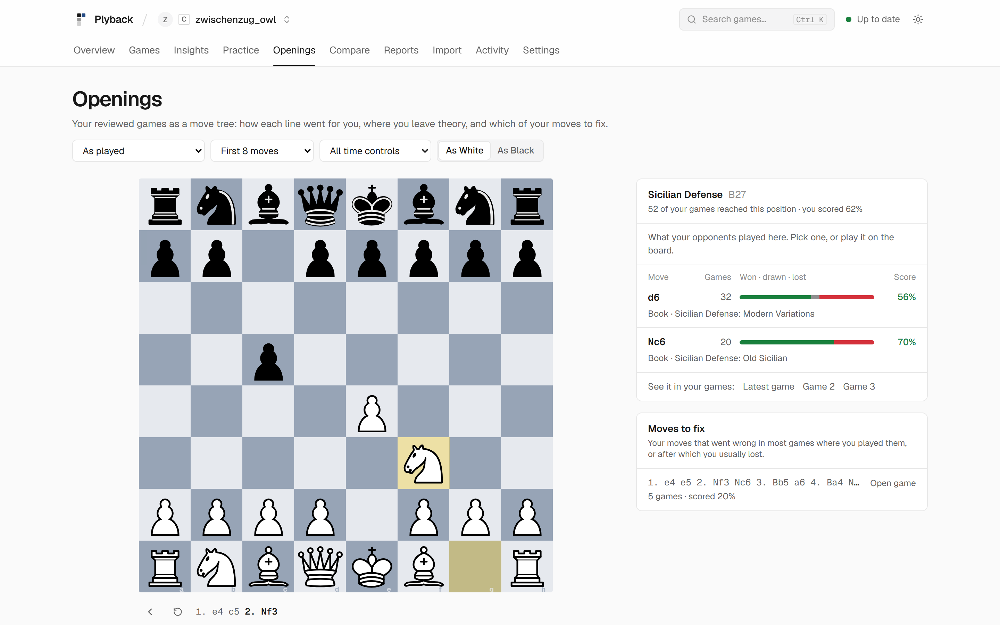
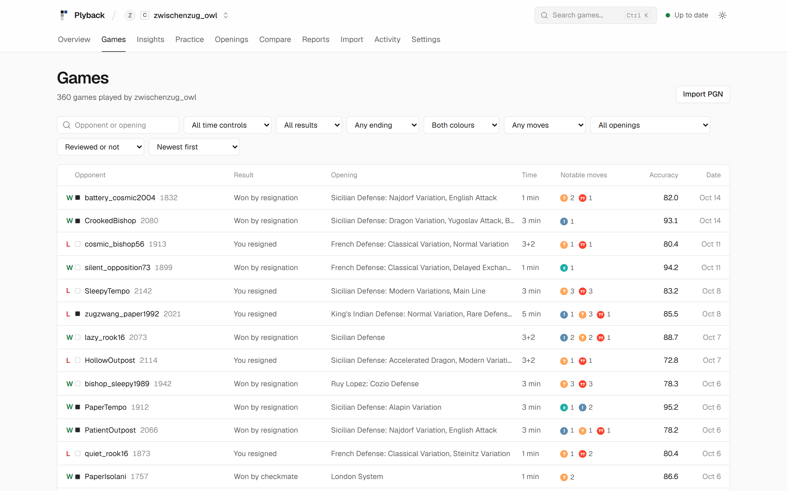

# Plyback

Self-hosted game review for Chess.com and Lichess, powered by Stockfish.

Plyback imports the games you play, reviews every one in the background and turns the reviews into
work you can act on: the mistakes you keep repeating, the openings where you go wrong, and positions
from your own games to solve again. It runs on your machine as one native program with a SQLite file.
No platform password, account or subscription is needed.

<picture>
  <source media="(prefers-color-scheme: dark)" srcset="docs/screenshots/review-dark.png">
  
</picture>

## What it does

- **Review** every game: move classifications, evaluation graph, engine lines, key moments, and free
  exploration on the board.
- **Insights** across an account: openings, game phases, recurring mistakes, time use, converting
  advantages, and playing sessions, each with a confidence label and links to the positions behind it.
- **Practice** positions taken from your own mistakes, on a spaced-repetition schedule, filtered by
  phase or tactical theme.
- **Openings** as a move tree of your games: results per line, where you leave theory, and the moves
  that keep losing.
- **Sync** public games from Chess.com and Lichess automatically, or import PGN files.
- **Compare** periods or accounts side by side, and save reports as fixed snapshots.

| Insights | Practice |
|---|---|
|  |  |
| **Openings** | **Games** |
|  |  |

The screenshots use sample data: 360 engine games for a fictional player rated around 2000, reviewed
by Plyback itself. In daily use on a desktop PC, Plyback keeps an account of over 1,300 games
(78,000 moves) reviewed, and a new game is ready about 10 seconds after it is imported.

## Getting started

You need [Rust](https://rustup.rs) 1.97.1 or newer and [Node.js](https://nodejs.org) 22.12 or newer to
build. The built app needs neither.

```sh
# macOS / Linux
bash setup.sh
bash start.sh
```

```powershell
# Windows
powershell -ExecutionPolicy Bypass -File setup.ps1
.\start.ps1
```

Open [localhost:8000](http://localhost:8000) and add a Chess.com or Lichess username. Setup builds the
interface and downloads Stockfish from its official release, checked against a pinned SHA-256.

With Docker, set a password for the first start:

```sh
PLYBACK_PASSWORD='choose-a-strong-one' docker compose up -d --build
```

## How it works

A Rust server (Axum, shakmaty) syncs games, runs a queue of Stockfish workers and stores everything in
SQLite. The interface is React and TypeScript. Positions already searched are cached, so re-reviews are
fast, and an interrupted review continues after a restart.

Classifications use documented heuristics based on expected-points loss, not Chess.com's proprietary
algorithm, so labels and accuracy can differ from Chess.com. [METHODOLOGY.md](METHODOLOGY.md)
describes every rule and threshold.

## Documentation

- [Self-hosting](docs/self-hosting.md): network access, Docker, backups, upgrades, configuration
- [Methodology](METHODOLOGY.md): how moves are classified and insights are computed
- [Architecture](docs/architecture.md): components, data model, analysis pipeline
- [Security](SECURITY.md): what is protected and how to run behind a proxy
- [Contributing](CONTRIBUTING.md): development setup and checks

## License

[GPL-3.0-or-later](LICENSE). Stockfish is downloaded separately from its official release. Opening
names come from the CC0 [Lichess chess-openings](https://github.com/lichess-org/chess-openings) dataset.
See [third-party notices](THIRD_PARTY_NOTICES.md).
